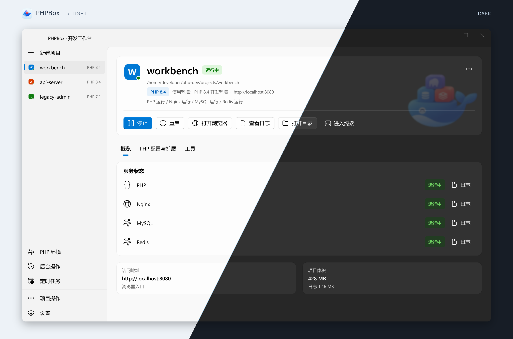

# phpbox

在 Linux 上做 PHP 开发，最麻烦的通常不是写代码，而是维护环境：
不同项目要不同的 PHP 版本，不同扩展组合，日志、容器、端口、Xdebug 和构建过程又分散在一堆 Docker 命令里。

`phpbox` 用 Docker 管理 PHP 开发环境。多个项目可以共享一个 PHP 环境，也可以使用各自的独立环境；GUI 和 CLI 统一提供项目管理、命令执行、日志和构建入口。




## 特性

- 支持 PHP `7.2` 到 `8.4`
- 支持 `60+` PHP 扩展
- 图形化创建、管理、启动、停止项目
- 共享 PHP 环境、项目环境切换；同版本允许创建多套配置
- 内置 Xdebug 配置能力
- 支持查看日志、进入容器、执行命令
- 支持 Wayland 与 X11 环境
- 提供面向日常开发的 CLI

## 环境要求

- Linux
- Docker
- `docker compose` 或 `docker-compose`
- Python `3.8–3.14`

如果你主要使用 CLI，也建议先确保：

```bash
docker info
docker compose version
```

发布包以 Linux x86_64、Ubuntu 22.04 / Debian 12 或更新系统为兼容基线。其他发行版建议在目标系统构建。
Python 3.8/3.9 使用固定的 Qt 6.7 依赖，Python 3.10–3.14 使用固定的 Qt 6.10 依赖；依赖版本见 `requirements.txt`。
CI 覆盖 Python 3.8、3.14 以及 offscreen、X11、Wayland 启动，发布前必须通过。

运行回归测试：

```bash
QT_QPA_PLATFORM=offscreen .venv/bin/python -m unittest discover -s tests -v
```

真实 Docker 验收会创建临时项目、网络和镜像，并在结束时清理这些 Docker 资源：

```bash
QT_QPA_PLATFORM=offscreen .venv/bin/python -m tests.integration_environments
# 网络需要代理时，可额外设置 PHPBOX_TEST_PROXY=http://127.0.0.1:7890
```

也可以手动运行 GitHub Actions 中的 `PHP environments integration` 工作流。

## 共享 PHP 环境

1. 在侧边栏打开 **PHP 环境 → 新建环境**，填写名称，选择 PHP 版本、扩展和可选构建代理。
2. 创建项目时选择已有环境。两个项目选择同一环境时，使用同一个 PHP 容器；Nginx 和可选数据库仍由各项目管理。
3. 在项目页右上角的 **三点菜单** 中点击 **切换 PHP 环境**，选择目标、检查环境并确认；同一菜单的 **管理 PHP 环境** 可打开环境管理页。已运行的环境之间切换不重建 PHP 容器；目标未启动时会先启动。

环境保存于 `~/php-dev/environments/<环境 ID>/`，名称修改不影响容器身份。同版本需要不同配置时新建另一个环境。环境只使用一套 PHP-FPM 配置，不划分项目 FPM pool。项目页的 **PHP 配置与扩展** 中可点击参数直接编辑；**工具 → 编辑配置** 可修改当前环境的 `php.ini`，也可编辑该项目的 Nginx 配置。共享环境的 PHP 修改会显示受影响项目，确认后在后台应用；运行中的环境会重启，失败时恢复原配置。项目页的 Xdebug 入口可直接打开当前环境的配置与扩展窗口；环境页仍提供配置、扩展和重建入口。

共享环境与普通项目复用同一套镜像模板，包括对应 PHP 版本的 `php.ini-development` 默认配置、Composer、Oh My Zsh 和终端插件，以及 `proxy` / `noproxy` / `ckproxy` 快捷命令。环境的 `php/php.ini` 用于覆盖默认参数；迁移项目不会自动导入旧项目的 PHP 配置，重建也不会覆盖已有环境配置。旧环境更新应用后需在环境页重建一次才能获得新增工具和默认配置。

构建代理会转换为容器可访问的宿主机地址，运行时代理变量默认清空。在终端执行 `proxy` 可手动启用环境中配置的代理，`noproxy` 关闭；修改环境代理地址会重建以更新快捷命令。

切换会检查目标 PHP 环境运行状态、实际版本、代码可见性、常见缓存目录权限和 Nginx 路由，不根据 `composer.json` 或 `composer.lock` 中的 PHP、扩展要求阻止切换。不会运行 Composer，也不会修改应用的 `.env`、Composer 配置、锁文件或 `vendor`。

`pbox php`、`composer`、`exec php` 和新开的容器终端会使用当前绑定以及项目实际目录。已经打开的终端请重新打开。PHP / Cron 引擎日志属于共享环境；应用日志、Nginx 和任务日志仍归各项目所有。

**现有独立项目需要显式迁移。** 切换弹窗会展示容器路径、扩展、配置和数据库地址变化。首次迁移会重建该项目的 Nginx，保留数据库容器和数据卷；自定义 Dockerfile、特殊挂载或启动配置不会被自动转换。原配置及镜像身份保存在项目的 `.phpbox/independent-backup.json`。

共享 PHP 使用 `/workspaces/<项目>/<代码目录>`。MySQL / Redis 必须使用预览列出的唯一地址，例如 `mysql-<项目 ID>` 和 `redis-<项目 ID>`；不要继续使用共享网络里有歧义的 `mysql` 或 `redis`。PHPBox 将这些地址写入管理文件 `.env.phpbox`，应用自己的连接配置需要相应调整。

定时任务由环境内的 Cron 调度，关闭桌面应用后仍然执行。停止项目会禁用后续调度；切换前已经开始的任务继续在原环境执行，取消操作仍指向原容器。有活动任务时不能停止或重建环境，绑定中的环境不能删除。切换失败会恢复原配置；若程序异常退出留下切换记录，在切换弹窗选择 **恢复原环境** 后继续操作。

共享环境可以访问所有项目代码，并共享进程权限和资源，适用于同一用户的可信本地项目。需要隔离的项目应继续使用独立模式。

## 安装与运行

### 从源码运行

```bash
git clone https://github.com/xxyangyoulin/phpbox.git
cd phpbox

python -m venv .venv
source .venv/bin/activate
pip install -r requirements.txt

python main.py
```

### 构建可执行文件

```bash
./build.sh --bin
```

构建完成后，主程序位于：

```bash
dist/phpbox/phpbox
```

### 安装到系统

如果你已经构建好目录式产物，可以执行：

```bash
./install.sh install
```

安装后：

- 程序主体位于 `/opt/phpbox`
- 启动命令为 `phpbox`，也可以使用简写 `pbox`，例如 `pbox -h`、`pbox list`

通过安装脚本或 `.deb` 包安装时，会自动创建 `pbox` 到 `phpbox` 的符号链接，无需配置 Shell 别名。

## GUI 功能

图形界面适合这些操作：

- 创建新项目
- 选择 PHP 版本
- 选择并安装 PHP 扩展
- 可选启用 MySQL / Redis
- 修改项目配置
- 管理 Xdebug
- 查看项目状态、运行日志和访问地址

典型流程：

1. 点击“新建项目”
2. 输入项目名称
3. 选择 PHP 版本和端口
4. 按需选择 PHP 扩展
5. 如有需要，启用 MySQL / Redis
6. 创建并启动项目

### 定时任务

停用任务只停止后续调度，不终止已经开始的执行。同一任务运行期间再次触发会跳过，避免重叠执行。
任务日志查看每次最多读取最近 20 个文件的末尾 64 KiB；日志窗口仅显示有限历史记录。
项目重命名会保留 Compose 项目标识，以继续使用原数据库卷。

### 可选服务

新建项目时可以额外启用：

- MySQL
- Redis

默认连接方式如下：

#### MySQL

- Host: `127.0.0.1`
- Port: 你在创建项目时设置的端口，默认 `3306`
- Database: 默认使用项目名
- User: 默认 `app`
- Password: 默认 `app`

#### Redis

- Host: `127.0.0.1`
- Port: 你在创建项目时设置的端口，默认 `6379`

创建项目后，项目根目录还会生成一个 `.env.phpbox`，里面会写入推荐连接参数：

- 容器内 PHP 代码使用 `mysql:3306`、`redis:6379`
- 宿主机工具使用 `127.0.0.1:你设置的映射端口`

## CLI

`pbox` 与 `phpbox` 是同一个程序。直接运行 `pbox` 打开图形界面；以下 CLI 命令不需要图形桌面。

### 帮助与项目选择

```bash
pbox --version
pbox --help                  # 总览、默认行为和常见示例
pbox help --all              # 完整手册：包括所有子命令及参数
pbox help exec
pbox help env create
man pbox                    # install.sh 或 deb 安装后可用

pbox -p workbench status
pbox -C ~/php-dev/projects/workbench/workbench php -v
```

所有项目命令支持 `-p/--project NAME`；省略时从当前目录向上识别项目。`-C/--directory DIR` 先切换宿主机工作目录。常规命令也接受命令后的 `-p/-C`。`php/composer/artisan/think` 是透传命令，PHPBox 参数必须放在命令之前。

`list` 始终列出全部项目；`status/ps` 默认查看当前项目，在项目外则查看全部。`--all` 强制查看全部，与指定项目互斥。

```bash
pbox list
pbox list -q                 # 仅项目名，不连接 Docker
pbox list --json
pbox status workbench --json
pbox status --all --check    # 任一项目未运行/不健康或无项目时失败
```

查询命令默认只表示“查询是否成功”：已停止项目仍返回 0；使用 `status --check` 才按健康状态判断。Docker 不可用时显示未知并返回非零，不再把查询失败当成全部停止。

### 项目生命周期

| 命令 | 行为 |
| --- | --- |
| `start [NAME]` / `up [NAME]` | 启动项目，必要时启动绑定的 PHP 环境 |
| `stop [NAME]` | 停止项目容器，保留容器 |
| `restart [NAME]` | 重启现有容器，不重新创建，不应用新镜像/Compose 配置 |
| `build [NAME]` / `rebuild [NAME]` | 同义命令，仅构建独立项目镜像，支持 `--no-cache` |
| `recreate [NAME]` | 使用现有镜像和配置重新创建容器，不执行构建 |
| `down [NAME]` | 移除项目容器，保留代码、配置和命名数据卷 |

`recreate/down` 会替换或移除容器可写层。共享项目的 `stop/down/restart/recreate` 不会停止或重建共享 PHP；需要操作共享 PHP 时使用 `env` 命令。

**行为变化：** 独立项目的 `restart` 现在只重启容器。原先构建后执行 `restart` 的流程应改为：

```bash
pbox build --no-cache
pbox recreate
```

### 执行命令与管道

```bash
pbox -p workbench php -r 'echo PHP_VERSION;'
pbox php -d memory_limit=1G script.php
pbox composer --no-interaction install
pbox artisan migrate
pbox think queue:listen
pbox shell                  # 默认 php，优先 zsh/bash/sh
pbox shell nginx
pbox -p workbench exec -T mysql -- mysql --defaults-extra-file=/tmp/client.cnf < backup.sql
pbox exec -u root -w /tmp php -- ls -la
pbox -T php script.php > result.txt
```

数据库导入示例要求容器内已准备好 `/tmp/client.cnf` 客户端凭据配置。

`php/composer/artisan/think` 保留参数原始顺序和内容。`pbox php --help` 查看 PHP 自身帮助，`pbox help php` 查看 PHPBox 包装层说明；参数前的一个 `--` 分隔符会被移除。`exec` 的 PHPBox 选项放在服务名之前，服务名后的内容属于目标命令。

自动终端模式要求 stdin 和 stdout 都是终端；`-T/--no-tty` 禁用伪终端，`-t/--tty` 强制启用。`exec/shell` 支持 `-u/--user` 和 `-w/--workdir`，后者必须是容器内绝对路径。服务支持 `php/nginx/mysql/redis/cron`；共享模式下 `cron` 与 `php` 路由到同一环境容器。

PHP 和 Composer 自动映射当前代码子目录；Artisan 和 ThinkPHP 命令从代码根目录执行框架入口文件。独立项目遵循 Compose 用户配置，共享 PHP 默认使用宿主机 UID:GID。

### 日志与诊断

```bash
pbox logs                   # 最近 200 行，输出后退出
pbox logs -f --service php --tail 100 --since 1h --timestamps
pbox logs workbench --service cron --tail all --no-color
pbox doctor
pbox doctor --json
```

**行为变化：** `logs` 默认不再持续跟踪，使用 `-f/--follow` 开启；`--no-follow` 仍可使用。`--since` 支持 Docker 接受的相对时长和时间格式。重定向时自动禁用 Compose 颜色，输出及时刷新。

共享项目默认包含项目 Compose 与共享 PHP 环境日志，来自不同来源的输出按到达顺序显示。共享 PHP 日志可能包含其他绑定项目，不能按项目隔离；`--service php/cron` 在共享模式下读取同一个环境日志。

`doctor` 检查 Docker 命令、Compose、Docker 守护进程，缺少任何必要条件都失败。无桌面的服务器不需要终端模拟器或系统打开器。

### 共享 PHP 环境

```bash
pbox env list
pbox env list -q             # 仅环境 ID，不连接 Docker
pbox env inspect php84 --json
pbox env create php84 --php 8.4 --extension redis --extension gd --start
pbox env start php84
pbox env stop php84 --yes
pbox env restart php84 --yes
pbox env rebuild php84 --no-cache --yes
pbox env delete unused-env --yes

pbox -p workbench use php72 --check
pbox -p workbench use php72
pbox recover workbench
```

环境可按完整 ID 或唯一名称选择，重名时使用 ID。`create` 生成标准环境配置并构建镜像，默认不启动，`--start` 构建后启动；失败时保留环境文件，可用 `env rebuild` 重试。`--extension` 可重复，省略时不额外安装扩展；安装器按 PHP 版本选择兼容扩展。`--proxy URL` 用于构建和终端代理快捷命令，不自动启用运行时全局代理，宿主机回环地址会转换。

停止、重启、重建共享环境会影响所有绑定项目，执行前显示影响范围并确认；非交互脚本需显式传 `--yes`。重建会更新运行中的环境。这些操作复用 GUI 的任务检查和操作锁。删除环境需要确认，并拒绝删除仍被项目绑定的环境。

`use` 允许升降版本，不根据 `composer.json/lock` 阻止切换，也不导入旧 `php.ini`。`--check` 检查迁移和目标运行条件，不修改绑定，但可能启动目标环境并生成项目身份文件。切换使用现有路由验证和恢复逻辑；中断或失败后存在未完成记录时可执行 `recover` 恢复原环境。

### 输出、退出码和补全

查询结果写入 stdout，PHPBox 进度和错误写入 stderr。`--json` 输出使用固定英文键；`-q/--quiet` 隐藏 PHPBox 进度，不隐藏错误和被执行程序的输出。`--verbose` 显示完整底层操作错误。

退出码：`0` 成功、`1` 操作失败、`2` 参数错误、`130` Ctrl+C、`143` SIGTERM、`141` 输出管道关闭。容器命令保留自身退出码。正常中断不打印 Python 堆栈，本地子进程会被回收。

`install.sh` 和 deb 安装 Bash/Zsh/Fish 补全及 man 手册，也可以手动加载：

```bash
source <(pbox completion bash)
# Zsh：先执行 autoload -Uz compinit && compinit
source <(pbox completion zsh)
# Fish：
pbox completion fish | source
```

补全包含命令、项目名、环境 ID 和服务名，候选查询不启动或连接 Docker。项目创建、交互配置编辑等仍可通过 `pbox gui --new-project` 和图形界面操作。

## 构建与发布

### 本地构建

```bash
./build.sh --bin
./build.sh --appimage
./build.sh --deb
```

说明：

- `--bin` 生成目录式可执行产物
- `--appimage` 构建 AppImage
- `--deb` 构建 `.deb` 包，需要系统中存在 `dpkg-deb`

在 Arch Linux 上，`dpkg-deb` 来自：

```bash
sudo pacman -S dpkg
```

### GitHub Actions

项目已配置 GitHub Actions 构建流程。推送版本 tag 后会自动构建并发布：

```bash
git tag v1.0.14
git push origin v1.0.14
```

## Wayland 与 tmux

项目已支持 Wayland。若在 Hyprland 等环境下出现“明明在 Wayland 中却像走了 XWayland”的情况，先检查当前 shell 环境：

```bash
echo "$XDG_SESSION_TYPE"
echo "$WAYLAND_DISPLAY"
```

如果你通过旧的 `tmux` session 进入图形环境，可能会继承到 `tty` 环境变量。此时建议：

```bash
tmux kill-server
tmux
```

并在 `~/.tmux.conf` 中加入：

```tmux
set -g update-environment "DISPLAY WAYLAND_DISPLAY XAUTHORITY XDG_CURRENT_DESKTOP XDG_SESSION_TYPE XDG_RUNTIME_DIR DBUS_SESSION_BUS_ADDRESS"
```

## 技术栈

| 技术 | 版本 |
|------|------|
| PyQt6 | >= 6.5.0 |
| PyQt6-Fluent-Widgets | >= 1.4.0 |
| Docker & Docker Compose | - |

## 许可证

MIT License
